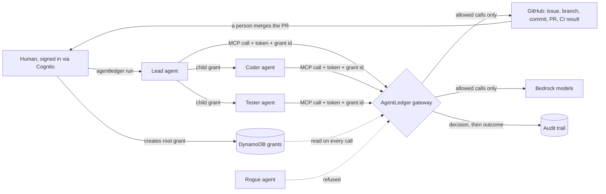

# AgentLedger

AI agents can act in real systems, but nobody can say who allowed what, or stop one mid-run.
AgentLedger gives each agent a verified identity and a time-limited grant from a human, checks both on every call, and records every decision.

[](https://github.com/OumarouDG/Agent-Ledger/actions/workflows/tests.yml)

## How it works

1. **Identity.** Each agent has its own Cognito app client and gets a signed access token. A human signs in with Cognito through the CLI.
2. **Grant.** A signed-in human creates a grant in DynamoDB: which agent, which workflow, which tools, which repository and branch prefix, which models, and when it expires (4 hours at most). An agent can pass a smaller grant to another agent (a child grant). Revoking the root also stops its children.
3. **Gateway.** Agents never hold GitHub or AWS credentials. Every tool call goes to the AgentLedger gateway (FastMCP). It checks the token, the grant, the workflow and the resource on each call. Any doubt is a denial.
4. **Audit.** Every decision (allow or deny) is written before the action runs. If the record cannot be written, the call is denied. The result of the action is written after it. A Sentinel locks a grant that keeps breaking its limits.



## What a run proves

Verified human, agent token, active grant, allowed GitHub change, commit SHA, passing test on that exact SHA, a pull request merged by a person, and a timeline you can read. `scripts/work_chain.py` prints that chain for one workflow and says `VALIDATED` or `ACCEPTED` only when the evidence is there.

## Quickstart

Needs Python, the repo venv, AWS access and the gateway tunnel. Full steps are in `cli/README.md` and `infra/README.md`.

```powershell
pip install -r requirements.txt
pip install -e cli
.\scripts\start-tunnel.ps1                       # gateway at http://127.0.0.1:18000/mcp
agentledger login                                # sign in as a human
agentledger grant create --agent agent_coder --workflow wf_demo --tools get_issue --repo OumarouDG/agentledger-demo
agentledger run --issue 1 --step                 # Lead, Coder, Tester: issue to pull request
agentledger probe --workflow <wf from the run>   # a rogue agent is refused
python scripts/audit_timeline.py                 # read the record
```

Use `agentledger grant revoke <id>` to stop an agent. The next call is denied.

## Measured

These numbers come from one session on Nov 7 through the SSM tunnel. They are not benchmarks.

- A run goes from issue to pull request with passing CI in about 30 seconds.
- A revoke before Coder's next call: denied in 165 ms (`parent_grant_revoked`).
- The probe is refused 7 times out of 7, including the Sentinel lock.
- 974 tests passed with `--live` (Josh's run).

## Limits

- The gateway only controls tool calls that go through it. It cannot see a developer's local shell or files, and the demo repo cannot lock `main` on a free private plan.
- Agent tokens last 12 hours and cannot be revoked early. Grants are what get revoked.
- The audit file is a plain file on the server. It is not tamper-proof. CloudWatch, if set up, is a viewing copy.
- The Sentinel lock is gateway-local and lives in a file.
- The EC2 instance role is broad. This is not a least-privilege setup.
- A person merges every pull request. The agents have no merge tool.

## More

- `cli/README.md`: login, grants, `run`, `probe`
- `infra/README.md`: Cognito and DynamoDB setup
- `docs/gateway.md`: the gateway, tools and audit
- `docs/try-it.md`: run it yourself, no AWS needed
- `docs/demo.md`: demo runbook
- `docs/demo-timing.md`: five-minute plan
- `docs/judge-qa.md`: likely questions
